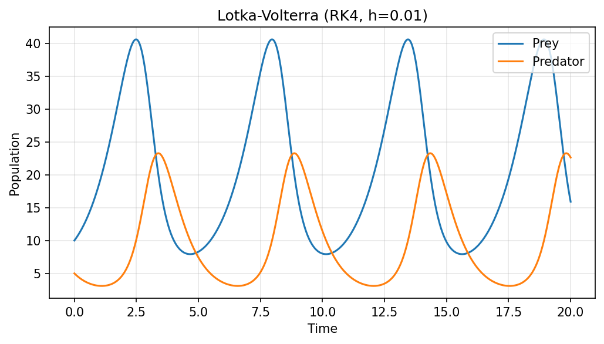
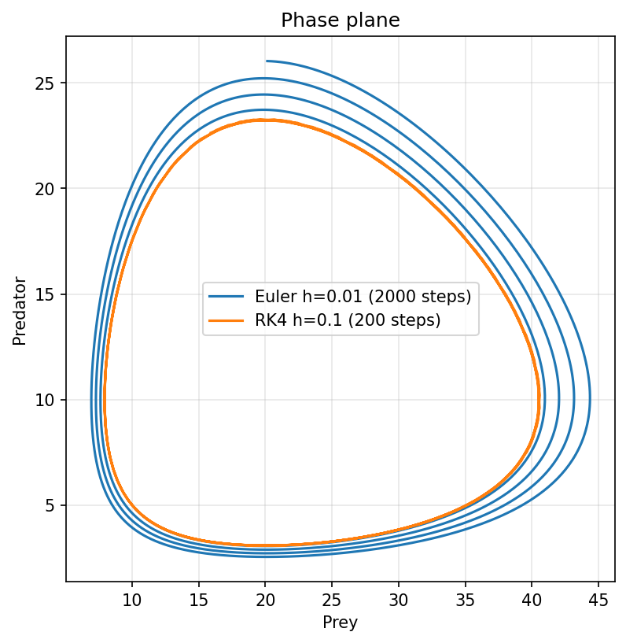
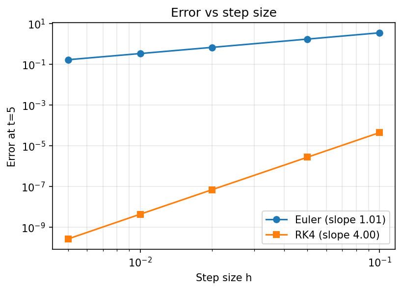
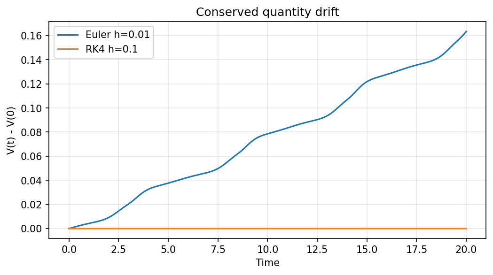

# Lotka-Volterra ODE Solver: Euler vs RK4

Numerical solution of the predator-prey model, with Euler and RK4
implemented from scratch in NumPy and validated against SciPy.

## Model
dx/dt = αx − βxy,  dy/dt = δxy − γy
Parameters: α=1.0, β=0.1, δ=0.075, γ=1.5; x0=10, y0=5, t∈[0,20]

## Methods
- Euler (order 1) and Runge-Kutta 4 (order 4), written from scratch
- Reference solution: scipy.integrate.solve_ivp (DOP853, rtol=1e-12)

## Results
- Measured convergence slopes (log-log, error at t=5):
  Euler 1.01, RK4 4.00, matching theory.
- In the phase plane, Euler spirals outward (h=0.01, 2000 steps),
  while RK4 stays on a closed orbit with 10x fewer steps
  (h=0.1, 200 steps).
- The system has a conserved quantity
  V = δx − γ ln x + βy − α ln y. Euler's V drifts upward
  (about 0.16 by t=20); RK4's stays nearly constant.

## Run
pip install -r requirements.txt
python lotka_volterra.py
